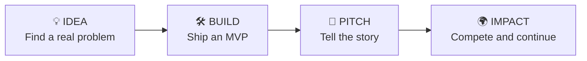

 

[**Join us**](#-how-to-join) ·
[**Tracks**](#-our-tracks) ·
[**Hackathons**](#-hackathons-and-solutions) ·
[**Events**](#-upcoming-events) ·
[**Team**](#-meet-the-team) ·
[**Roadmaps**](https://github.com/GDG-TUM/member-roadmaps) ·
[**Chapter board**](https://github.com/orgs/GDG-TUM/projects/1) ·
[**LinkedIn**](https://www.linkedin.com/company/gdg-on-campus-tum/)

---

## 👋 About us

We are a **student-led developer community** at the Technical University of Mombasa. We learn by building, share what we know, and grow together through hands-on workshops, study jams, hackathons and open-source projects. Beginners are welcome, and so is everyone else.

## ✨ Why join

| | |
|---|---|
| 🧠 **Learn by doing** | Every track is built around hands-on labs and projects, not just slides |
| 🌐 **Build a public portfolio** | Your work lives on GitHub, where recruiters and collaborators can see it |
| 🤝 **Learn with peers and mentors** | Members at every level help each other grow |
| 🚀 **Ship real things** | Turn real problems in our community into working solutions |
| 🔗 **Open doors** | Events, talks and connections across the wider tech ecosystem |

## 🚀 What we do

| | |
|---|---|
| 🛠️ **Workshops & study jams** | Practical sessions on Google technologies and modern development tools |
| 🧱 **Projects** | Real products built by students for real problems |
| 🏆 **Hackathons & buildathons** | Weekly challenges and preparation for the Google Solution Challenge |
| 🎤 **Tech talks** | Industry speakers and member-led sessions |
| 🔓 **Open source** | Contributing to community repositories with real pull requests |

## 🧭 Our tracks

Pick the track that matches what you want to learn. You can join more than one.

| Track | What you'll learn | Tools you'll touch | Start here |
|:------|:------------------|:-------------------|:-----------|
| ☁️ **Cloud** | Google Cloud, DevOps, cloud security, infrastructure |  | [**Open →**](https://github.com/GDG-TUM/Cloud-Track-GDG-on-Campus-TUM) |
| 🤖 **AI / ML** | Machine learning, generative AI, data |  | [**Open →**](https://github.com/GDG-TUM/AI-ML-Track-GDG-on-Campus-TUM) |
| 📱 **Mobile** | Android and cross-platform apps |  | [**Open →**](https://github.com/GDG-TUM/Mobile-Development-Track-GDG-on-Campus-TUM) |
| 🔐 **Cybersecurity** | Ethical hacking, red team, SOC, secure coding |  | [**Open →**](https://github.com/GDG-TUM/CYBERSECURITY-TRACK-GDG-on-Campus-TUM) |
| 👩‍💻 **Women in Tech** | Community, mentorship and learning for women in tech | 💜 | [**Open →**](https://github.com/GDG-TUM/WOMEN-IN-TECH-TRACK) |
| 🏆 **Hackathons & Solutions** | Problem discovery, MVPs, pitching, Google Solution Challenge | 💡 | [**Open →**](https://github.com/GDG-TUM/GDGoC-TUM-Hackathon-Structure) |
| 🌐 **Web** | Frontend, backend, full-stack development |  | 🔜 Opening soon |

## 🏆 Hackathons and Solutions

Our hackathon programme makes competitions approachable for beginners. It combines a semester roadmap, weekly cross-track buildathons and a clear path from idea to demo.

### Semester roadmap: 19 October to 14 December 2026

| Block | Dates | Focus | You'll walk away with |
|:-----:|:------|:------|:----------------------|
| **1** | 19 Oct – 1 Nov | Foundations, problem discovery, SDGs, team formation | A problem statement, a target user and a team |
| **2** | 2 – 15 Nov | Ideation, solution design, MVP planning | A chosen solution, MVP scope and a build plan |
| **3** | 16 – 29 Nov | Build with Google, prototype, validate, iterate | A working prototype and recorded feedback |
| **4** | 30 Nov – 14 Dec | Pitching, demo practice, competition readiness | A pitch deck, a rehearsed demo and next steps |

### Weekly buildathons

We run **at least two buildathon challenges every week** across Web, Cloud, Mobile, AI/ML and Cybersecurity. Challenges are announced in the official GDG groups, so watch there for deadlines and submission instructions.

[**Explore the full hackathon programme →**](https://github.com/GDG-TUM/GDGoC-TUM-Hackathon-Structure)

## 📅 Upcoming events

<!-- UPCOMING:START -->
<table>
  <tr>
    <td>

### 📱 Mobile Development

an interactive session that includes an Android Studio tour and setup, a quick Kotlin workshop, and a captivating Flutter demo

**You'll learn how to:**
- an interactive session that includes an Android Studio tour and setup, a quick Kotlin workshop, and a captivating Flutter demo,

[**👉 Register for free**](https://gdg.community.dev/events/details/google-gdg-on-campus-technical-university-of-mombasa-mombasa-kenya-presents-kickstart-your-mobile-development-journey/)

</td>
  </tr>
</table>
<!-- UPCOMING:END -->

> 🔔 More sessions are announced on our [GDG community page](https://gdg.community.dev/gdg-on-campus-technical-university-of-mombasa-mombasa-kenya/), on [LinkedIn](https://www.linkedin.com/company/gdg-on-campus-tum/) and on the [chapter board](https://github.com/orgs/GDG-TUM/projects/1).

## 🕘 Past events

A look at what we've already run this semester.

<!-- PAST:START -->
| Date | Event | Track |
|:-----|:------|:------|
| 21 Oct 2026 | [Web Development Essentials Make-Up Session](https://gdg.community.dev/events/details/google-gdg-on-campus-technical-university-of-mombasa-mombasa-kenya-presents-web-development-essentials-make-up-session-1/) | 🎉 Community |
| 19 Oct 2026 | [Tools of the Trade Workshop: Linux, Git, & Docker](https://gdg.community.dev/events/details/google-gdg-on-campus-technical-university-of-mombasa-mombasa-kenya-presents-tools-of-the-trade-workshop-linux-git-amp-docker/) | ☁️ Cloud |
| 16 Oct 2026 | [Discovering the Cybersecurity World: Would You Survive a Phishing Attack?](https://gdg.community.dev/events/details/google-gdg-on-campus-technical-university-of-mombasa-mombasa-kenya-presents-discovering-the-cybersecurity-world-would-you-survive-a-phishing-attack/) | 🔐 Cybersecurity |
| 15 Oct 2026 | [AI/ML Track Launch: Introduction and Python Basics for AI/ML](https://gdg.community.dev/events/details/google-gdg-on-campus-technical-university-of-mombasa-mombasa-kenya-presents-aiml-track-launch-introduction-and-python-basics-for-aiml/) | 🤖 AI / ML |
| 15 Oct 2026 | [Kickstart Your Web Development Journey](https://gdg.community.dev/events/details/google-gdg-on-campus-technical-university-of-mombasa-mombasa-kenya-presents-kickstart-your-web-development-journey/) | 🌐 Web |
| 12 Oct 2026 | [Cloud Track Week 1: Cloud Fundamentals](https://gdg.community.dev/events/details/google-gdg-on-campus-technical-university-of-mombasa-mombasa-kenya-presents-cloud-track-week-1-cloud-fundamentals/) | ☁️ Cloud |
<!-- PAST:END -->

[**See all past events →**](https://gdg.community.dev/gdg-on-campus-technical-university-of-mombasa-mombasa-kenya/)

## 🪜 Your learning path

| Stage | What it looks like |
|:------|:-------------------|
| 🌱 **Explorer** | You've joined, set up your tools and attended your first sessions |
| 🔨 **Builder** | You're completing track labs and shipping your first project |
| 🌟 **Contributor** | You're opening pull requests, helping peers and presenting at sessions |
| 🧭 **Leader** | You're mentoring members or leading a track |

## 🤝 How to join

| Step | What to do |
|:----:|:-----------|
| **1** | **Join the organization.** The core team will send you an invitation. Turn on two-factor authentication once you're in. |
| **2** | **Share your plan** for the year by opening a Member Roadmap issue in [member-roadmaps](https://github.com/GDG-TUM/member-roadmaps). |
| **3** | **Pick a track** from the table above and follow its setup guide, weekly sessions and resources. |
| **4** | **Join a buildathon.** Watch the official groups for the weekly challenges and team up through the [hackathon programme](https://github.com/GDG-TUM/GDGoC-TUM-Hackathon-Structure). |
| **5** | **Contribute.** Read the [contributing guide](https://github.com/GDG-TUM/.github/blob/main/CONTRIBUTING.md), pick an issue labelled `good first issue`, and open a pull request. |
| **6** | **Stay in the loop.** Follow us on [LinkedIn](https://www.linkedin.com/company/gdg-on-campus-tum/) for events and news. |

## 👥 Meet the team

### Chapter leadership

<table align="center">
  <tr>
    <td align="center" width="50%">
       
      <b>Michelle Ndunge</b> 🧭 Chapter Lead
    </td>
    <td align="center" width="50%">
       
      <b>Rooney Odhiambo</b> 🤝 VC Chair
    </td>
  </tr>
</table>

### Track and programme leads

<table align="center">
  <tr>
    <td align="center" width="25%">
       
      <b>Mark Karuga</b> ☁️ Cloud Track Lead
    </td>
    <td align="center" width="25%">
       
      <b>Lewis Kagiri</b> 🤖 AI / ML Track Lead
    </td>
    <td align="center" width="25%">
       
      <b>Ian Chacha</b> 📱 Mobile Track Lead
    </td>
    <td align="center" width="25%">
       
      <b>Kimberly Gift</b> 🔐 Cybersecurity Track Lead
    </td>
  </tr>
  <tr>
    <td align="center" width="25%">
       
      <b>Larah Flynn</b> 👩‍💻 Women in Tech Lead
    </td>
    <td align="center" width="25%">
       
      <b>Edith Karanja</b> 🏆 Hackathons & Solutions
    </td>
    <td align="center" width="25%">
       
      <b>Sam Ryan</b> 🌐 Web Development
    </td>
    <td align="center" width="25%">
       
    </td>
  </tr>
</table>

### 🧭 Who to talk to

| If you want to... | Reach out to |
|:------------------|:-------------|
| Join the chapter, partner with us or ask general questions | Chapter Lead and VC Chair |
| Learn cloud, DevOps or Google Cloud | Cloud Track Lead |
| Explore machine learning and generative AI | AI / ML Track Lead |
| Build Android or cross-platform apps | Mobile Track Lead |
| Get into ethical hacking, SOC or secure coding | Cybersecurity Track Lead |
| Find mentorship and community for women in tech | Women in Tech Lead |
| Prepare for hackathons or the Google Solution Challenge | Hackathons & Solutions Lead |
| Learn frontend, backend or full-stack development | Web Development Lead |

> **Want to lead?** Active members who contribute, mentor and show up consistently are the ones who grow into leadership roles. Start with the [learning path](#-your-learning-path) and let a track lead know you're interested.

<b>❓ New here? Common questions</b>

 

**Do I need experience?** No. Every track has beginner-friendly material.

**Does it cost anything?** No, joining is free.

**Can I join more than one track?** Yes.

**I'm not a computer science student. Can I join?** Yes. Anyone at the university who wants to learn is welcome.

**I've never done a hackathon. Is it for me?** Yes. The hackathon programme is designed for beginners and walks you from finding a problem to presenting a demo.

**How do I get invited to the organization?** Contact the core team using the details below and they will send you an invitation.

## 🛡️ Community

We want everyone to feel welcome here. Please read our [Code of Conduct](https://github.com/GDG-TUM/.github/blob/main/CODE_OF_CONDUCT.md). To report a security problem, see our [Security Policy](https://github.com/GDG-TUM/.github/blob/main/SECURITY.md).

## 📬 Contact

✉️ [gdgtum@gmail.com](mailto:gdgtum@gmail.com) · 💼 [LinkedIn](https://www.linkedin.com/company/gdg-on-campus-tum/)

*We think you're going to like it here.* 💙

