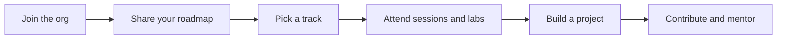

 

[**Join us**](#-how-to-join) ·
[**Tracks**](#-our-tracks) ·
[**Learning path**](#-your-learning-path) ·
[**Roadmaps**](https://github.com/GDG-TUM/member-roadmaps) ·
[**Chapter board**](https://github.com/orgs/GDG-TUM/projects/1) ·
[**LinkedIn**](https://www.linkedin.com/company/gdg-on-campus-tum/)

---

## 👋 About us

We are a **student-led developer community** at the Technical University of Mombasa. We learn by building, share what we know, and grow together through hands-on workshops, study jams, hackathons and open-source projects. Beginners are welcome, and so is everyone else.

## ✨ Why join

| | |
|---|---|
| 🧠 **Learn by doing** | Every track is built around hands-on labs and projects, not just slides |
| 🌐 **Build a public portfolio** | Your work lives on GitHub, where recruiters and collaborators can see it |
| 🤝 **Learn with peers and mentors** | Members at every level help each other grow |
| 🚀 **Ship real things** | Solve problems in our own community and campus |
| 🔗 **Open doors** | Events, talks and connections across the wider tech ecosystem |

## 🚀 What we do

| | |
|---|---|
| 🛠️ **Workshops & study jams** | Practical sessions on Google technologies and modern development tools |
| 🧱 **Projects** | Real products built by students for real problems |
| 🏆 **Hackathons & challenges** | Building under pressure and learning from each other |
| 🎤 **Tech talks** | Industry speakers and member-led sessions |
| 🔓 **Open source** | Contributing to community repositories with real pull requests |

## 🧭 Our tracks

Pick the track that matches what you want to learn. You can join more than one.

| Track | What you'll learn | Tools you'll touch | Start here |
|:------|:------------------|:-------------------|:-----------|
| ☁️ **Cloud** | Google Cloud, DevOps, cloud security, infrastructure |  | [**Open →**](https://github.com/GDG-TUM/Cloud-Track-GDG-on-Campus-TUM) |
| 🤖 **AI / ML** | Machine learning, generative AI, data |  | [**Open →**](https://github.com/GDG-TUM/AI-ML-Track-GDG-on-Campus-TUM) |
| 📱 **Mobile** | Android and cross-platform apps |  | [**Open →**](https://github.com/GDG-TUM/Mobile-Development-Track-GDG-on-Campus-TUM) |
| 🔐 **Cybersecurity** | Ethical hacking, red team, SOC, secure coding |  | [**Open →**](https://github.com/GDG-TUM/CYBERSECURITY-TRACK-GDG-on-Campus-TUM) |
| 👩‍💻 **Women in Tech** | Community, mentorship and learning for women in tech | 💜 | [**Open →**](https://github.com/GDG-TUM/WOMEN-IN-TECH-TRACK) |
| 🌐 **Web** | Frontend, backend, full-stack development |  | 🔜 Opening soon |

## 🪜 Your learning path

| Stage | What it looks like |
|:------|:-------------------|
| 🌱 **Explorer** | You've joined, set up your tools and attended your first sessions |
| 🔨 **Builder** | You're completing track labs and shipping your first project |
| 🌟 **Contributor** | You're opening pull requests, helping peers and presenting at sessions |
| 🧭 **Leader** | You're mentoring members or leading a track |

## 🤝 How to join

| Step | What to do |
|:----:|:-----------|
| **1** | **Join the organization.** The core team will send you an invitation. Turn on two-factor authentication once you're in. |
| **2** | **Share your plan** for the year by opening a Member Roadmap issue in [member-roadmaps](https://github.com/GDG-TUM/member-roadmaps). |
| **3** | **Pick a track** from the table above and follow its setup guide, weekly sessions and resources. |
| **4** | **Contribute.** Read the [contributing guide](https://github.com/GDG-TUM/.github/blob/main/CONTRIBUTING.md), pick an issue labelled `good first issue`, and open a pull request. |
| **5** | **Stay in the loop.** Follow us on [LinkedIn](https://www.linkedin.com/company/gdg-on-campus-tum/) for events and news. |

## 🛠️ Featured projects

> Projects built by our members will be showcased here.

| Project | Track | Description |
|:--------|:------|:------------|
| 🔗 *[Project name](#)* | ☁️ Cloud | *One line on what it does and who it helps* |
| 🔗 *[Project name](#)* | 🤖 AI / ML | *One line on what it does and who it helps* |
| 🔗 *[Project name](#)* | 📱 Mobile | *One line on what it does and who it helps* |

## 📅 Events

| When | What | Where |
|:-----|:-----|:------|
| *Date TBA* | 🎉 Kickoff and welcome session | *Venue TBA* |
| *Date TBA* | 🛠️ First track workshops | *Venue TBA* |
| *Date TBA* | 🏆 Community hackathon | *Venue TBA* |

Dates will be posted on [LinkedIn](https://www.linkedin.com/company/gdg-on-campus-tum/) and on the [chapter board](https://github.com/orgs/GDG-TUM/projects/1).

## 👥 Meet the team

| Role | Name |
|:-----|:-----|
| 🧭 **Chapter Lead** | *Name* |
| ☁️ **Cloud Track Lead** | *Name* |
| 🤖 **AI / ML Track Lead** | *Name* |
| 📱 **Mobile Track Lead** | *Name* |
| 🔐 **Cybersecurity Track Lead** | *Name* |
| 👩‍💻 **Women in Tech Lead** | *Name* |

<b>❓ New here? Common questions</b>

 

**Do I need experience?** No. Every track has beginner-friendly material.

**Does it cost anything?** No, joining is free.

**Can I join more than one track?** Yes.

**I'm not a computer science student. Can I join?** Yes. Anyone at the university who wants to learn is welcome.

**How do I get invited to the organization?** Contact the core team using the details below and they will send you an invitation.

## 📂 What you'll find here

Workshop materials, track learning paths, community projects and starter templates. Browse the repositories, pick something that interests you, and contribute.

## 🛡️ Community

We want everyone to feel welcome here. Please read our [Code of Conduct](https://github.com/GDG-TUM/.github/blob/main/CODE_OF_CONDUCT.md). To report a security problem, see our [Security Policy](https://github.com/GDG-TUM/.github/blob/main/SECURITY.md).

## 📬 Contact

✉️ [gdgtum@gmail.com](mailto:gdgtum@gmail.com) · 💼 [LinkedIn](https://www.linkedin.com/company/gdg-on-campus-tum/)

*We think you're going to like it here.* 💙

